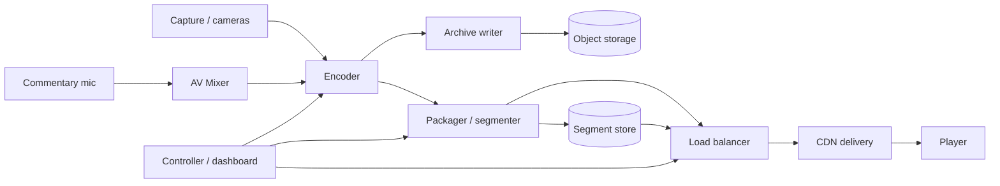
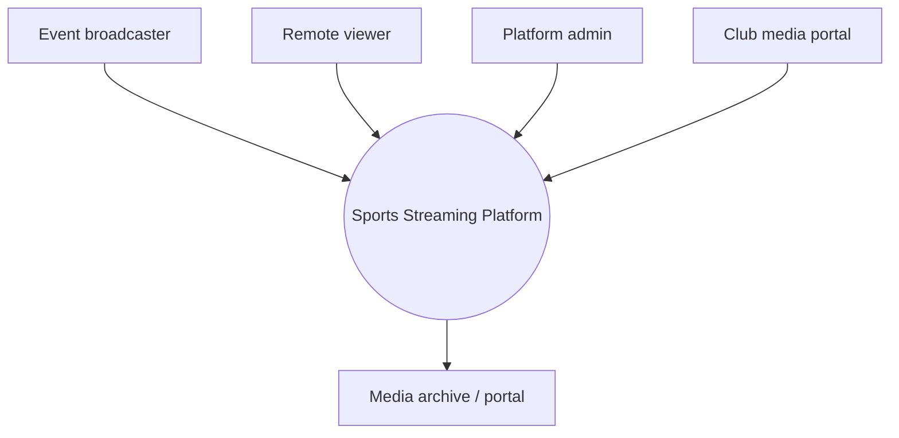
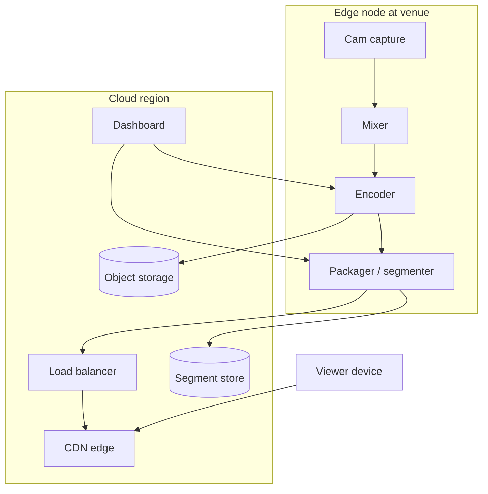

# Sports Event Streaming Platform: Labs 1 to 3

Domain: live sports event streaming (multi-camera video, audio, telemetry).

Course project for *Architectures of Multimedia and Smart Systems*. Lab 1 covers the system context, requirements, architecture views, architecture decision records and quality scenarios, following ISO/IEC/IEEE 42010. Lab 2 adds the media processing pipeline, the quality ladder for adaptive streaming and the measurements behind the quality of experience. Lab 3 adds the telemetry channel of the wearables: an MQTT sensor channel, an edge and a server component, and the load test that finds the throughput of the chain.

## How to view the diagrams

Open the `.svg` files in `docs/diagrams/` in a browser: `context.svg`, `components.svg`, `deployment.svg`. The `.mmd` files next to them are the sources, and each SVG is rendered from its source with:

```bash
npx @mermaid-js/mermaid-cli -i docs/diagrams/components.mmd \
    -o docs/diagrams/components.svg -t dark -b '#020817'
```

## Contents

- `docs/requirements.md`: context, stakeholders, data register, FRs, NFRs
- `docs/quality-scenarios.md`: two quality attribute scenarios
- `docs/adr/`: six records, 0001 to 0003 from Lab 1, 0004 from Lab 2, 0005 and 0006 from Lab 3
- `docs/pipeline.md`: Lab 2 session 1, source material, pipeline, H.264 against AV1
- `docs/qoe.md`: Lab 2 session 2, ladder, network profiles, QoE, link to the architecture
- `pipeline/pipeline.py`: decoding, transformation, encoding, measurement
- `stream/package.sh`, `stream/player.html`: ladder, packaging, QoE instrumentation
- `results/encoding.csv`, `results/qoe.csv`: the measurements
- `tools/qoe_measure.mjs`: QoE runs in Chrome over the DevTools protocol
- `docs/telemetry.md`: Lab 3, the topics, the message schema, the error handling policy, the channel check
- `docs/deployment.md`: Lab 3, the components, the patterns, the link break, the load, scalability, the stack
- `smart/`: the sensor emulator, the subscriber, the gateway, the broker configuration, the compose file
- `results/load.csv`, `results/docker_stats.csv`, `results/latency.png`: the load test, the resource use of every step and the chart

## Lab 2, how to reproduce

FFmpeg 6 or newer with `libx264` and `libsvtav1`, Python 3 with OpenCV, Node.js 18 or newer, Chrome.

```bash
# 0. environment
python3 -m venv .venv && source .venv/bin/activate    # Windows: .venv/Scripts/activate
pip install -r pipeline/requirements.txt

# 1. source material: data/raw.mov at 1920x1080, 30 fps, 60 s, no audio
#    Not committed. The exact ffmpeg command is in docs/pipeline.md.

# 2. session 1: reference, four variants, results/encoding.csv  (~3.5 min)
python pipeline/pipeline.py

# 3. session 2: ladder and 2 s HLS segments  (~1 min)
./stream/package.sh

# 4. serve the stream, with stream/ as the site root
python -m http.server 8000 --directory stream

# 5. manual QoE at http://localhost:8000/player.html
#    F12, Network, Disable cache, Throttling, then add the profiles of docs/qoe.md

# 6. automated QoE: three profiles, two runs each
cd tools && npm install && cd ..
node tools/qoe_measure.mjs --repeats 2 --out results/qoe.csv
```

The experiments quoted in `docs/qoe.md`:

```bash
BOTTOM=1 ./stream/package.sh                       # four-rung ladder into stream/hls4/
node tools/qoe_measure.mjs --profiles P3:700:400 --src hls4/master.m3u8 --repeats 2
node tools/qoe_measure.mjs --profiles P3:700:400 --startlevel 0 --repeats 2
node tools/qoe_measure.mjs --profiles P1:8000:40 --drop-after 12 --drop-to P3
```

## Results

| | |
|---|---|
| Uncompressed rate by formula (1) | 1.49 Gbit/s (1920×1080, 30 fps, 24 bit) |
| H.264 at 1080p30, 2500 and 5000 kbit/s | PSNR 40.13 and 43.30 dB, SSIM 0.9677 and 0.9815 |
| AV1 at 1080p30, 2500 and 5000 kbit/s | PSNR 41.96 and 43.93 dB, SSIM 0.9727 and 0.9797 |
| AV1 saving at equal quality | 27 % by SSIM, 37 % by PSNR |
| Ladder | 1080p at 3000, 720p at 1330, 480p at 590 kbit/s, constant 0.048 bit/pixel |
| Stall ratio on the worst profile | 0.088 with three rungs, 0.022 with the fourth |
| Startup on the worst profile | 9.2 s with the manifest default, 2.5 s with `startLevel: 0` |

`data/` and the HLS segments stay out of Git. The manifests, the scripts and the measurement tables are committed.

## Lab 3, how to reproduce

Eclipse Mosquitto 2.1.4, Python 3.13 with `paho-mqtt` and `matplotlib`, SQLite, Docker and Docker Compose.

```bash
# 1. the deployment of record: five services, two networks, the edge limits
docker compose -f smart/docker-compose.yml up -d --build
docker compose -f smart/docker-compose.yml ps

# 2. the channel check: the emulator with four kinds of injected fault
DROP=0.02 DUP=0.01 LATE=0.01 BAD=0.01 HZ=20 DURATION=30 \
    docker compose -f smart/docker-compose.yml run --rm --no-deps sensors
python smart/stats.py                  # rate, loss ratio, gaps, duplicates, latency

# 3. the break: the gateway leaves the cloud network and comes back
python smart/break_test.py             # ~2 min, writes data/break.json

# 4. the load test and the chart (~12 min, samples docker stats per step)
./smart/loadtest.sh
```

`smart/run_native.py` starts the same five processes without Docker, for a machine that has no daemon. The numbers in this repository come from the compose deployment.

## Lab 3 results

| | |
|---|---|
| Message schema | `dev`, `boot`, `seq`, `ts`, `qty`, `val`, `unit`; 110 bytes of payload, 152 with topic and header |
| Channel check, 1800 readings with 2 % / 1 % / 1 % / 1 % faults | 1800 sent, 1746 stored, loss ratio 0.030, 65 gaps, 14 duplicates, 11 out of order, 17 rejected |
| Link break, 60 s at 300 messages/s | buffer 17 835 records, drained in 38 s, 33 383 sent and 33 383 stored, loss 0 |
| Throughput of the chain | Θ 760 to 844 messages/s, with 822 for the 1000 kbit/s uplink inside that band; the gateway at 50 % of its core |
| Latency below Θ | 2.4 to 4.9 ms mean, 10 ms at the 95th percentile |
| Loss above Θ | 12.4 % at 1200 messages/s, 40.3 % at 1350, 42.0 % at 1500, dropped by the queue of the edge broker |

## Media licence

`data/raw.mov` comes from *Durango Rugby Taldea jugando vídeo.ogv* by Txo, Wikimedia Commons, CC BY-SA 4.0. `docs/pipeline.md` has the attribution and the normalisation command.

## Architecture diagrams

### 1. Components



### 2. Context



### 3. Deployment


