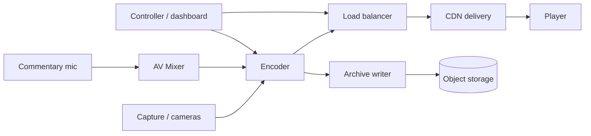

# Sports Event Streaming Platform — Labs 1–2

Domain: live sports event streaming (multi-camera video, audio, telemetry).

This repository is the course project for *Architectures of Multimedia and Smart
Systems*. Lab 1 describes the system context, requirements, architecture views,
architecture decision records (ADRs) and quality scenarios, following
ISO/IEC/IEEE 42010. Lab 2 adds a working media processing pipeline, a quality
ladder for adaptive streaming and the measurements of the quality of experience.

## How to view the diagrams
Open the .svg files in docs/diagrams/ in any web browser:
context.svg, components.svg, deployment.svg.
The .mmd sources are the editable Mermaid sources.

## Contents
- docs/requirements.md - context, stakeholders, data register, FRs, NFRs
- docs/quality-scenarios.md - two quality attribute scenarios
- docs/adr/ - four architecture decision records (0001–0003 from Lab 1, 0004 from Lab 2)
- docs/pipeline.md - Lab 2, session 1: source material, pipeline, comparison of H.264 and AV1
- docs/qoe.md - Lab 2, session 2: ladder, network profiles, QoE, link to the architecture
- pipeline/pipeline.py - decoding → transformation → encoding → measurement
- stream/package.sh, stream/player.html - quality ladder, packaging, QoE instrumentation
- results/encoding.csv, results/qoe.csv - the measurements
- tools/qoe_measure.mjs - automated QoE runs in Chrome over the DevTools protocol

## Lab 2 — how to reproduce

Requirements: FFmpeg ≥ 6 with `libx264` and `libsvtav1`, Python 3 with OpenCV,
Node.js ≥ 18 and Chrome.

```bash
# 0. environment
python3 -m venv .venv && source .venv/bin/activate    # Windows: .venv/Scripts/activate
pip install -r pipeline/requirements.txt

# 1. source material (see docs/pipeline.md, "Source material" — CC BY-SA 4.0)
#    data/raw.mov: 1920x1080, 30 fps, 60 s, no audio
#    It is not committed; the exact ffmpeg command is in docs/pipeline.md.

# 2. session 1: reference + four variants + results/encoding.csv  (~3.5 min)
python pipeline/pipeline.py

# 3. session 2: ladder + 2 s HLS segments  (~1 min)
./stream/package.sh

# 4. serve the stream (site root = stream/)
python -m http.server 8000 --directory stream

# 5. manual QoE: http://localhost:8000/player.html
#    F12 → Network → Disable cache → Throttling → add the profiles of docs/qoe.md

# 6. automated QoE: three profiles x two runs -> results/qoe.csv
cd tools && npm install && cd ..
node tools/qoe_measure.mjs --repeats 2 --out results/qoe.csv
```

Optional experiments used in docs/qoe.md:

```bash
BOTTOM=1 ./stream/package.sh                       # 4-level ladder -> stream/hls4/
node tools/qoe_measure.mjs --profiles P3:700:400 --src hls4/master.m3u8 --repeats 2
node tools/qoe_measure.mjs --profiles P3:700:400 --startlevel 0 --repeats 2   # initial level
node tools/qoe_measure.mjs --profiles P1:8000:40 --drop-after 12 --drop-to P3 # bandwidth drop
```

## Results at a glance

| | |
|---|---|
| Uncompressed rate, formula (1) | 1.49 Gbit/s (1920×1080, 30 fps, 24 bit) |
| H.264 1080p30, 2500 / 5000 kbit/s | PSNR 40.13 / 43.30 dB, SSIM 0.9677 / 0.9815 |
| AV1 1080p30, 2500 / 5000 kbit/s | PSNR 41.94 / 43.94 dB, SSIM 0.9726 / 0.9797 |
| AV1 saving at equal quality | 27 % (SSIM) … 37 % (PSNR) |
| Ladder | 1080p @ 3000, 720p @ 1330, 480p @ 590 kbit/s (0.048 bit/pixel) |
| Stall ratio on the worst profile | 0.088 (3 rungs) → 0.022 (+ 640×360 @ 330 kbit/s) |
| Startup on the worst profile | 9.2 s (default initial level) → 2.5 s (`startLevel: 0`) |

Media files (`data/`, the HLS segments) are excluded from Git; only the manifests,
the scripts and the measurement tables are committed.

## Media licence
`data/raw.mov` is derived from *Durango Rugby Taldea jugando vídeo.ogv* by **Txo**,
Wikimedia Commons, **CC BY-SA 4.0** — see docs/pipeline.md for the attribution and
the exact normalisation command.

## Architecture Diagrams
### 1.components

### 2.context
```mermaid
graph TB
  broadcaster[Event broadcaster] --> SYS((Sports Streaming Platform))
  viewer[Remote viewer] --> SYS
  admin[Platform admin] --> SYS
  club[Club media portal] --> SYS
  SYS --> LMS[Media archive / portal]
  ```

  ### 3.deployment
  ```mermaid
graph TB
  subgraph Edge[Edge node at venue]
    C1[Cam capture]
    E1[Encoder]
    M1[Mixer]
  end
  subgraph Cloud[Cloud region]
    LBn[Load balancer]
    CDNn[CDN edge]
    ST[(Object storage)]
    DASH[Dashboard]
  end
  C1 --> M1 --> E1 --> LBn --> CDNn
  E1 --> ST
  DASH --> E1
  CLIENT[Viewer device] --> CDNn
   ```
